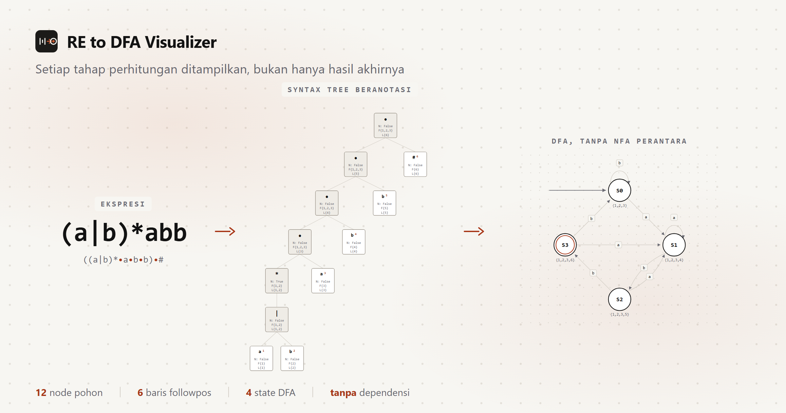

# RE to DFA Visualizer



Alat web untuk mempelajari konversi **regular expression (RE)** menjadi **deterministic finite automaton (DFA)** secara langsung melalui *syntax tree* dan `followpos`, tanpa NFA perantara. Setiap tahap perhitungan ditampilkan, bukan hanya hasil akhirnya.

Dibuat untuk mahasiswa, dosen, dan praktisi yang ingin memeriksa *mengapa* sebuah DFA terbentuk, bukan sekadar menerimanya.

## Isi

- **Ekspresi dan preprocessing** — validasi input, penyisipan konkatenasi eksplisit `•`, dan augmentasi menjadi `(r)•#`.
- **Syntax tree beranotasi** — setiap node menampilkan `nullable`, `firstpos`, dan `lastpos`; daun bernomor posisi.
- **Tabel followpos** — klik barisnya untuk menyorot posisi daun pada pohon, state DFA yang memuat posisi itu, dan transisi yang dipicunya.
- **Tabel dan diagram DFA** — satu tabel gabungan dengan kolom himpunan posisi, transisi per simbol, dan peran state. Diagram digambar sebagai SVG.
- **Minimisasi DFA** — bandingkan hasil konstruksi langsung dengan DFA minimum, lengkap dengan langkah partisi Moore putaran demi putaran.
- **Simulator string** — telusuri string langkah demi langkah dan lihat hasilnya diterima atau ditolak.
- **Mode terang dan gelap** — keduanya memenuhi kontras WCAG AA.

## Menjalankan

Butuh Node.js 18 atau lebih baru. Tidak ada dependensi, jadi tidak perlu `npm install`.

```bash
npm run serve     # http://localhost:4173
npm test          # menjalankan seluruh uji
npm run build     # menyalin berkas aplikasi ke public/ untuk deploy
```

`index.html` memuat JavaScript sebagai modul ES, dan browser memblokir modul dari `file://`. Jadi buka lewat `npm run serve`, bukan dengan klik dua kali pada `index.html`.

## Sintaks ekspresi

| Bentuk | Arti |
| :--- | :--- |
| `a`, `b`, `0`, `1` | simbol alfabet, satu karakter |
| `r1\|r2` | pilihan (alternasi) |
| `r1r2` | konkatenasi |
| `r*` | Kleene star |
| `(r)` | pengelompokan |
| `r1•r2`, `r1.r2` | konkatenasi eksplisit (sama dengan `r1r2`) |
| `E` | string kosong (epsilon) |
| `\x` | karakter `x` sebagai simbol literal |

Karena `E` dipakai untuk string kosong, huruf E biasa ditulis `\E`. Karakter `#` dan `•` juga perlu di-escape bila ingin dipakai sebagai simbol.

Contoh:

| Ekspresi | Diterima | Ditolak |
| :--- | :--- | :--- |
| `a` | `a` | `` (kosong), `aa` |
| `a*` | ``, `a`, `aaa` | `b` |
| `a\|b` | `a`, `b` | `ab` |
| `(a\|b)*abb` | `abb`, `aabb`, `babb` | `aba`, `ab` |
| `E` | `` | `a` |
| `\*` | `*` | `a` |

## Struktur berkas

```
re-to-dfa-visualizer/
├── index.html                     antarmuka satu halaman, enam modul
├── styles.css                     token warna terang dan gelap, layout responsif
├── package.json                   skrip test, serve, dan build
├── banner-github.png              gambar banner untuk README
├── src/
│   ├── engine.js                  konversi RE ke DFA, minimisasi, simulator (tanpa DOM)
│   ├── diagram.js                 geometri dan gambar SVG diagram DFA
│   └── app.js                     rendering AST, tabel, diagram SVG, simulator, tema
├── scripts/
│   ├── serve.mjs                  server statis untuk pengembangan lokal
│   ├── prepare-public.mjs         menyalin berkas aplikasi ke public/ untuk deploy
│   └── make-banner.mjs            membuat ulang banner-github.png
└── netlify.toml                   konfigurasi deploy Netlify
```

Uji tidak disertakan di repositori publik ini. Untuk menjalankannya, letakkan berkas uji di `tests/` lalu jalankan `npm test`.

Logika konversi sengaja dipisahkan dari tampilan dan tidak menyentuh DOM, sehingga bisa diuji langsung dengan Node dan dipakai ulang di tempat lain.

## Cara kerja

1. Ekspresi divalidasi, lalu konkatenasi eksplisit disisipkan pada pasangan operand berurutan.
2. Ekspresi diaugmentasi menjadi `(r)•#`; penanda `#` menutup pohon dan menandai state penerima.
3. Parser *recursive descent* membangun AST dengan prioritas `*` > konkatenasi > `|`.
4. Setiap node diisi `nullable`, `firstpos`, dan `lastpos` secara *bottom-up*.
5. `followpos` dihitung dari dua aturan saja: node konkatenasi dan node Kleene star.
6. DFA dibangun dari `firstpos(root)`; state yang memuat posisi `#` bersifat menerima.
7. DFA minimum dihasilkan lewat partisi Moore, dengan state mati virtual agar transisi yang hilang tidak dianggap sama dengan transisi menuju state mati.

## Pengujian

65 uji berjalan dengan `node:test`, tanpa kerangka uji tambahan:

- **Ekuivalensi** — hasil DFA dibandingkan dengan pencocokan regex langsung untuk semua string hingga panjang empat.
- **Minimalitas** — setiap pasangan state pada DFA minimum dibuktikan bisa dibedakan oleh suatu string; jika tidak, hasilnya belum minimum.
- **Escape dan epsilon** — `\*`, `\#`, `\(`, `\.`, `\E`, dan `E`.
- **Kasus batas** — alfabet kosong, alfabet besar, ekspresi yang menolak segalanya, simbol di luar alfabet, pesan kesalahan.

## Deploy

Aplikasi ini statis tanpa langkah build, sehingga bisa diterbitkan di mana saja. Konfigurasi `netlify.toml` sudah disiapkan untuk Netlify: perintah build hanya menyalin `index.html`, `styles.css`, dan `src/` ke `public/`, sehingga berkas lain tidak ikut terbit.

Untuk deploy manual:

```bash
npx netlify deploy --prod
```

## Batas yang diketahui

- Konversi dibatasi 512 state untuk mencegah halaman membeku pada ekspresi besar.
- Panel minimisasi menampilkan kelompok state per putaran; diagram belum digambar ulang tiap putaran.
- Alfabet dibatasi satu karakter per simbol.
